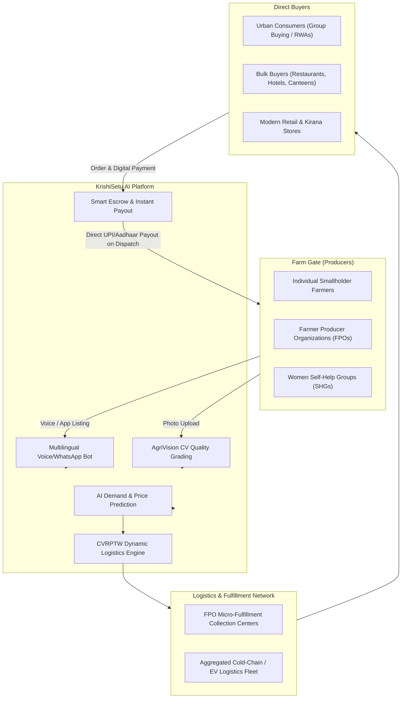
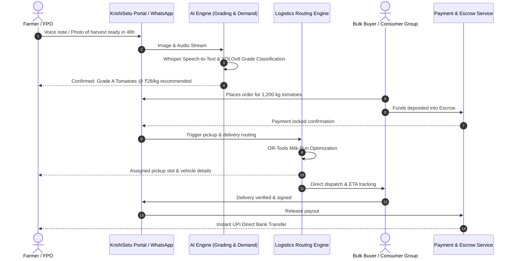
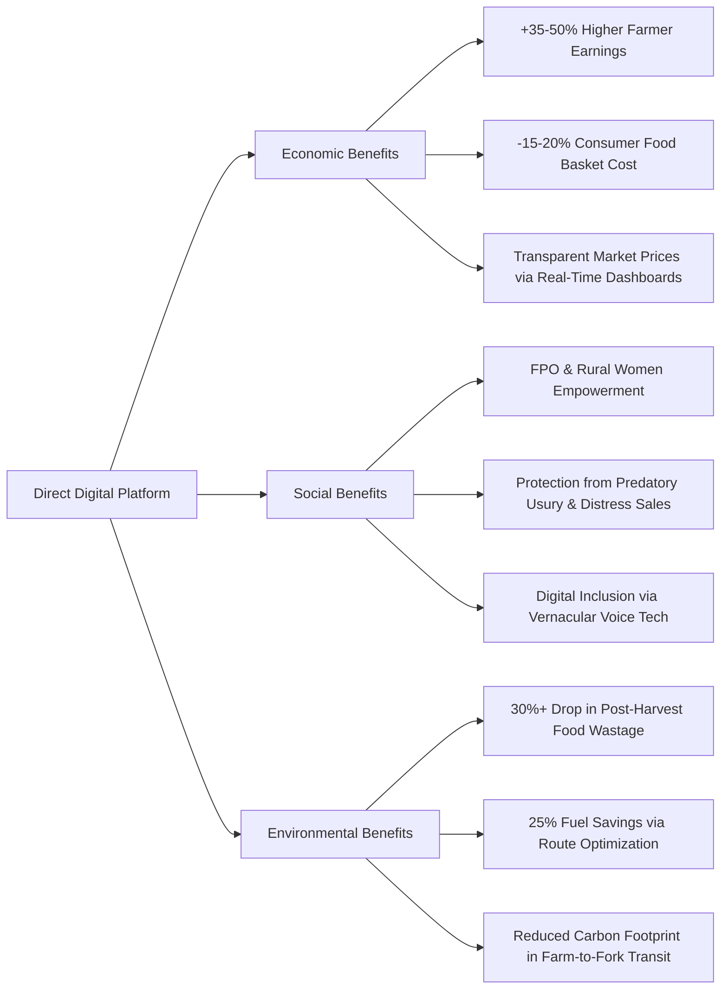

# Smart India Hackathon Workshop
# Date: 21-10-2026
## Reference Number: 26011247
## Name: V Kamalesh Kannan

## Problem Title
SIH 26033: Multiple intermediaries reduce farmers earnings and increase consumer prices.

## Problem Creater's Organization
Ministry of Consumer Affairs, Food & Public Distribution

## Theme
Agriculture, FoodTech & Rural Development

## Problem Description
In the conventional Indian agricultural supply chain, perishable and staple produce passes through 4 to 6 intermediary levels (local village aggregators, commission agents / *arhtiyas*, APMC mandi wholesalers, regional distributors, sub-wholesalers, and neighborhood retail vendors). This fragmented chain causes:
- **Severe Price Spread:** Farmers receive as little as 15% to 35% of the final consumer price.
- **High Post-Harvest Spoilage:** 20% to 30% of fruits and vegetables are wasted due to lack of cold storage, excessive transit handling, and delayed logistics.
- **Opaque Price Discovery:** Asymmetric market information forces farmers into distress selling.

**Expected Solution:** Create a digital marketplace that:
- Connects farmers/FPOs directly with consumers and bulk buyers (restaurants, retailers, institutions).
- Provides end-to-end logistics support with aggregation hubs.
- Uses AI for demand forecasting and dynamic route optimization.

**Benefits:**
- Better prices and higher profit realization for farmers (up to 65–75% of the consumer rupee).
- Lower, fair prices and fresher produce for consumers and bulk buyers.
- Drastic reduction in supply chain inefficiencies and food spoilage.

---

## Proposed Solution

### 1. Detailed Explanation of the Proposed Solution: "KrishiSetu AI"
**KrishiSetu AI** is a decentralized, multimodal B2B and B2C direct farm-to-fork digital ecosystem built to bypass intermediaries. It seamlessly links Farmer Producer Organizations (FPOs) and individual smallholder farmers with urban consumer clusters, institutional canteens, restaurants, and retail cooperatives.

The platform consists of four core operational modules:
1. **Multilingual & Voice-First Seller Portal:** Enables farmers with low literacy to list produce using WhatsApp Voice Notes and IVR telephony in regional languages (powered by Bhashini AI and Whisper).
2. **AI Quality Assessment ("AgriVision"):** Computer-vision quality grading via smartphone cameras that classifies produce into Standard Quality Grades (Grade A/B/C) using Agmarknet guidelines, preventing unfair price deductions.
3. **Dynamic Demand-Yield Matchmaker:** Machine learning algorithms aggregate micro-demands from urban residential communities and bulk buyers, matching them with upcoming harvests to prevent glut or shortage.
4. **Shared Logistics Pooling & Route Optimization Engine:** Solves the Capacitated Vehicle Routing Problem with Time Windows (CVRPTW) to dynamically plan multi-stop farm-gate pickups, aggregate produce at rural micro-fulfillment hubs, and coordinate consolidated direct transit.

### 2. How It Addresses the Problem
- **Direct Disintermediation:** Eliminates commission agents and middlemen by replacing physical mandi tiers with a transparent digital matchmaking and contracting layer.
- **Fair Value Redistribution:** Reallocates the ~45% markup traditionally absorbed by middlemen between farmers (+35% income) and consumers (-15% grocery expense).
- **Farm-Gate Aggregation:** Small farmers producing small quantities cannot afford individual transport. KrishiSetu aggregates neighborhood farm outputs into single vehicle milk-runs, solving the high per-unit logistics cost barrier.
- **Perishability Control:** Real-time logistics tracking and direct routing cut transit time by 40-50%, drastically reducing post-harvest wastage of perishable crops.

### 3. Innovation and Uniqueness
- **Hyper-Accessible Multilingual Voice UI:** Farmers do not need to navigate complex forms; an audio message like *"500 kg of hybrid tomatoes ready for harvest by Friday in Nashik"* is parsed using NLP into a verified marketplace listing.
- **Computer-Vision Farm-Gate Grading:** Eliminates subjective discounting by mandi agents who artificially downgrade produce quality.
- **Community Group Buying Protocol:** Aggregates urban residential societies into bulk delivery points, turning individual retail deliveries into ultra-low-cost bulk drop-offs.
- **Integrated Milestone Smart Escrow:** Resolves the chronic rural problem of payment delays and bad debts. Buyer funds are held in escrow and credited to the farmer's bank account instantly upon physical verification at the collection center.

---

## Technical Approach

### 1. Technologies to be Used

| Layer | Technologies / Tools | Purpose |
| :--- | :--- | :--- |
| **Mobile & Web UI** | Flutter, React.js, TailwindCSS, PWA | Cross-platform, low-bandwidth responsive interface |
| **Conversational Interface** | WhatsApp Business API, Twilio, Bhashini AI (Indic NLP), OpenAI Whisper | Multilingual voice and text listing for low-literacy farmers |
| **Backend & Microservices** | Python FastAPI, Node.js, Go (Routing Microservice) | High-performance asynchronous API endpoints and calculations |
| **Database & GIS** | PostgreSQL with PostGIS extension, Redis, MinIO/S3 | Spatial geo-queries, sub-second caching, and secure image storage |
| **AI / Machine Learning** | YOLOv8 / MobileNetV3 (Quality Grading), XGBoost & Prophet (Demand Forecasting) | Computer-vision crop classification, price trend and harvest forecasting |
| **Route Optimization Engine** | Google OR-Tools (CVRPTW), OpenStreetMap (OSRM), Mapbox API | Constrained vehicle routing, load capacity balancing, and live navigation |
| **Payments & Security** | NPCI UPI AutoPay, RazorpayX Escrow, OAuth2.0, JWT | Direct benefit transfer, secure escrow settlement, user authentication |
| **IoT & Telematics (Optional)** | ESP32, DHT22 sensors, GPS tracker modules | Cold-chain temperature, humidity, and location tracking in transit |

### 2. Methodology and Implementation Process

#### Step-by-Step Implementation Workflow:
1. **Producer Onboarding & Harvest Schedule Registry:**
   - Farmers or FPO managers register their land, crops, and expected harvest schedules.
   - Predictive models forecast cluster harvest volumes across geographies.
2. **AI-Assisted Quality Verification:**
   - Farmers photograph a sample tray of produce. The lightweight on-device model validates size, ripeness, surface blemish percentage, and suggests the Agmarknet grade.
3. **Algorithmic Dynamic Matching:**
   - Buyer orders are grouped by geo-clusters. The matcher pairs bulk demand with nearest available FPO clusters to minimize travel radius.
4. **Dynamic Route Optimization & Farm-Gate Pickup:**
   - The logistics engine runs the **Capacitated Vehicle Routing Problem with Time Windows (CVRPTW)** considering vehicle capacity, perishability deadlines, and rural road networks.
   - Generates the shortest multi-stop pickup path for shared vehicles, reducing empty return trips.
5. **Smart Escrow Settlement:**
   - Payment is collected upon order placement and locked in escrow. When the collection center scans the produce QR code, up to 70% advance is released instantly, and the remaining 30% is settled upon customer delivery.

---

## Feasibility and Viability

### 1. Analysis of Feasibility
- **Technical Feasibility:** The solution uses production-tested open-source libraries (OR-Tools, OpenCV, Flutter) that function reliably even over 2G/3G connectivity via offline-first PWA caching and WhatsApp conversational bots.
- **Operational Feasibility:** Leverages existing Government infrastructure including 10,000+ registered FPOs, Common Service Centres (CSCs), and National Agriculture Market (e-NAM) physical mandis as localized aggregation hubs.
- **Economic Viability:** Replaces the 20%–35% middleman margin with a modest 3%–5% platform convenience fee for maintenance, insurance, and logistics coordination. Unit economics are positive due to consolidated cargo pooling.

### 2. Potential Challenges and Risks

| Potential Challenge / Risk | Risk Level | Description |
| :--- | :---: | :--- |
| **Low Digital Literacy** | High | Smallholder farmers may find smartphone apps difficult or inaccessible. |
| **Last-Mile Rural Transport** | High | Poor road connectivity, scattered small farm plots, and shortage of refrigerated vehicles. |
| **Quality Dispute at Delivery** | Medium | Discrepancy between farmer-graded photo and actual delivered produce quality. |
| **Resistance from Middlemen** | Medium | Mandi commission agents (*arhtiyas*) exerting informal credit pressure on farmers. |

### 3. Strategies for Overcoming Challenges
- **Voice & Conversational Commerce:** Voice-based WhatsApp bots and local village CSC kiosks enable completely zero-typing listing.
- **Micro-Hub Logistics Aggregation:** Rather than sending vehicles to remote single farms, local FPOs manage decentralized micro-collection centers within a 5 km radius, acting as the primary loading node.
- **Standardized AI & Physical Sample Verification:** FPO collection centers perform a 30-second rapid scan of the produce crate to reconcile with the AI grade, generating a verifiable digital tamper-proof receipt.
- **Micro-Credit & Escrow Integration:** Partnering with regional rural banks (RRBs) and NABARD to provide working capital credit lines, liberating farmers from loan dependencies on traditional commission agents.

---

## Impact and Benefits

### 1. Potential Impact on Target Audience
- **Smallholder Farmers & FPOs:**
  - Realize a **35% to 50% increase in net income** by retaining the value margin previously lost to intermediaries.
  - Guaranteed instant digital payment eliminates chronic bad debt and delayed credit terms.
- **Consumers & Bulk Buyers (HoReCa):**
  - **15% to 20% lower retail prices** for fresh vegetables and staples.
  - Delivery of farm-fresh produce harvested within 12–24 hours instead of 48–72 hours via mandis.
- **Logistics Providers & Rural Youth:**
  - Generates rural employment for local pickup coordinators, vehicle drivers, and micro-hub sorters.

### 2. Measurable Multi-Dimensional Benefits

---

## Research and References

1. **Government of India - Dalwai Committee Report:** *Report of the Committee on Doubling Farmers' Income (DFI)*, Ministry of Agriculture & Farmers Welfare, Government of India.
2. **Food and Agriculture Organization (FAO):** *The State of Food and Agriculture: Moving forward on food loss and waste reduction*, United Nations.
3. **NITI Aayog Policy Papers:** *Promoting Direct Farmer-to-Consumer Marketing Channels and Agricultural Logistics Inclusivity*, NITI Aayog, New Delhi.
4. **Open Network for Digital Commerce (ONDC):** *Agriculture Domain Specification & Protocols for Farm-to-Fork Interoperability*, Department for Promotion of Industry and Internal Trade (DPIIT).
5. **Vehicle Routing Problem Research:** Toth, P., & Vigo, D., *Vehicle Routing: Problems, Methods, and Applications*, Society for Industrial and Applied Mathematics (SIAM).
6. **Agmarknet Portal:** Directorate of Marketing & Inspection (DMI), Ministry of Agriculture and Farmers Welfare, Government of India ([https://agmarknet.gov.in](https://agmarknet.gov.in)).
